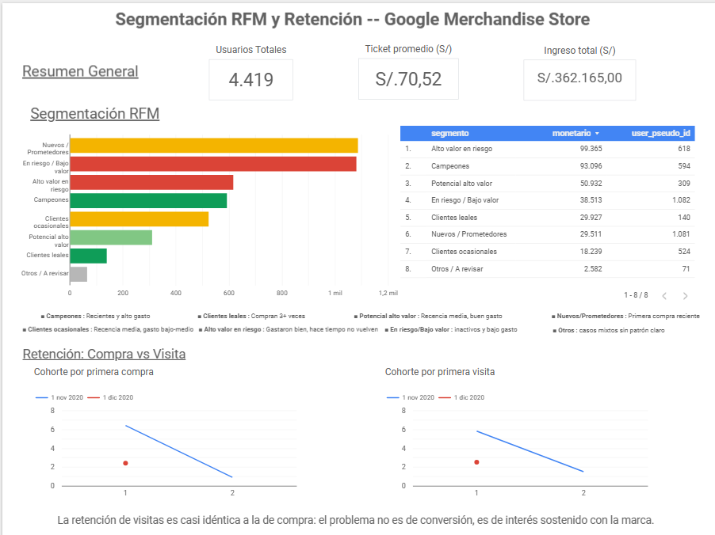

# Análisis de Retención y Segmentación de Clientes (RFM) con BigQuery

Análisis de comportamiento de compra para la tienda de merchandising de Google (Google Merchandise Store), usando datos reales de eventos de Google Analytics 4. El objetivo: identificar qué clientes retener y en qué punto del ciclo de vida se pierde a los compradores después de su primera compra.

## Problema de negocio

La tienda quiere saber **qué clientes vale la pena retener** y **dónde se pierde a la gente después de la primera compra**. En lugar de asumir un patrón de retención recurrente típico de e-commerce transaccional, el análisis parte de los datos para entender el comportamiento real de compra en una categoría de producto ocasional (merchandising de marca).

## Dataset

- **Fuente:** `bigquery-public-data.ga4_obfuscated_sample_ecommerce` (dataset público de BigQuery)
- **Contenido:** eventos reales de Google Analytics 4 de la Google Merchandise Store
- **Rango:** 1 de noviembre de 2020 – 31 de enero de 2021 (3 meses)
- **Contexto relevante:** el período incluye Black Friday, Cyber Monday y la temporada navideña, lo cual influye en la composición y el comportamiento de las cohortes de esos meses.

## Metodología

El análisis se construyó en 5 fases, cada una documentada en su propio archivo SQL dentro de `/sql`:

1. **Exploración y validación** (`01_exploracion.sql`) — entendimiento de la estructura del dataset y detección de problemas de calidad de datos.
2. **Tabla base de compras** (`02_tabla_base_compras.sql`) — construcción de una tabla limpia, con una fila por compra.
3. **Segmentación RFM** (`03_rfm_segmentacion.sql`) — cálculo de Recencia, Frecuencia y Monetario, con scores y segmentos de cliente.
4. **Análisis de cohortes por primera compra** (`04_cohortes_primera_compra.sql`) — retención mes a mes según el mes de primera compra.
5. **Análisis de cohortes por primera visita** (`05_cohortes_primera_visita.sql`) — retención mes a mes según el mes de primera visita al sitio (evento `session_start`), como contraste frente a la retención de compra.

## Decisiones de limpieza de datos

**`transaction_id` no es un identificador único confiable.** Se encontró un caso real de un mismo usuario con 2 compras distintas (distinto `event_timestamp` y `purchase_revenue`) compartiendo el mismo `transaction_id`. Por esta razón, se usó `event_timestamp` como grano de "una fila = una compra" (y, de igual forma, de "una visita" para el análisis de cohortes por sesión), ya que se confirmó que es único en todo el dataset tanto para el evento `purchase` como para `session_start`.

**Los valores faltantes no siempre son `NULL`.** GA4 marca algunos datos no recolectados con el string `'(not set)'` en lugar de dejarlos como `NULL`, por lo que fue necesario ajustar el criterio de limpieza para detectar ambos casos.

**7.9% de las compras (450 de ~5,700) tienen datos de ecommerce completamente vacíos** — sin `transaction_id` real (`'(not set)'`) ni `purchase_revenue`. Se verificó que tampoco hay información recuperable en el array `items` de esas filas (0 productos con datos reales), por lo que se confirma que son transacciones donde GA4 no capturó ningún dato económico, no un problema aislado del monto.

Criterio adoptado: estas 450 filas **se mantienen en la tabla base** y cuentan para la métrica de Frecuencia (si el usuario completó la compra, debe contar), pero **se excluyen del cálculo de Monetario** (no hay forma de saber cuánto gastaron). Como consecuencia, 353 usuarios (~8% del total) quedan con Monetario nulo — se excluyeron del cálculo de quintiles (`NTILE`) para esa métrica y se les asignó el score más bajo (1) como caso especial, evitando que distorsionen los percentiles del resto de usuarios.

## Hallazgos clave

**La compra recurrente es la excepción, no la norma.** El 82.5% de los compradores realizó una sola compra en la ventana de 3 meses analizada; solo el 17.5% volvió a comprar al menos una vez. Esto es consistente con el comportamiento esperado de una categoría de compra ocasional o de regalo, y cambia el enfoque del análisis: en vez de asumir retención recurrente como en e-commerce transaccional, el foco está en identificar qué distingue a ese 17.5% para informar estrategias de reactivación.

**La retención cae drásticamente después del primer mes.** De los compradores que entraron en noviembre, solo el 6.4% volvió a comprar un mes después; de los de diciembre, solo el 2.4%. La diferencia es notable: noviembre (que incluye Black Friday) retiene casi 3 veces mejor que diciembre. Una hipótesis plausible es que diciembre concentra compras de regalo de temporada, de intención única, mientras que noviembre atrae una mezcla distinta de compradores — aunque esto no se puede confirmar solo con estos datos.

**Volver al sitio no implica volver a comprar — y viceversa: la retención de visitas es prácticamente igual a la de compra.** Para contrastar lo anterior, se repitió el mismo análisis de cohortes usando como evento base `session_start` (cualquier visitante, no solo compradores). La hipótesis inicial era que la retención de *visitas* sería notablemente más alta que la de *compras* (la gente mira el catálogo sin comprar). Los datos no confirman esa hipótesis: la retención al mes 1 fue de 5.8% para la cohorte de visitantes de noviembre y 2.5% para la de diciembre — prácticamente idéntica a la retención de compra (6.4% y 2.4% respectivamente). Esto sugiere que el problema de retención no es de conversión (gente que visita pero no compra), sino de interés sostenido en general: quien visita el sitio una vez, rara vez vuelve a visitarlo, compre o no. Sí se observa, como era esperable, que el volumen de visitantes es mucho mayor al de compradores (ej. 78,383 visitantes de noviembre vs. 1,532 compradores de noviembre, ~2% de conversión a primera compra).

**La cohorte de enero solo tiene datos del mes 0** (su mes de entrada), porque es la cohorte más reciente del dataset: no ha tenido tiempo de generar un "mes 1" dentro de la ventana de datos disponible (que terminaría en febrero, fuera de rango). Esto aplica tanto a la cohorte de compra como a la de visita.

## Segmentación RFM

Se calcularon tres métricas por usuario:

- **Recencia (R):** días desde la última compra hasta una fecha de corte fija (1 de febrero de 2021, el día siguiente al final del dataset).
- **Frecuencia (F):** número total de compras del usuario (incluyendo las de monto desconocido).
- **Monetario (M):** suma del gasto total del usuario (excluyendo las compras de monto desconocido).

Cada métrica se convirtió en un score de 1 a 5. Para R y M se usaron quintiles (`NTILE`), pero **F se calculó con reglas de negocio en lugar de `NTILE`**: dado que el 82.5% de usuarios comparte el mismo valor de frecuencia (1 compra), repartir ese grupo en quintiles producía asignaciones arbitrarias sin sentido de negocio (usuarios con 1 sola compra recibiendo scores altos de "fidelidad"). En su lugar, se definió: 1 compra → score 1, 2 compras → score 3, 3+ compras → score 5.

Con los tres scores combinados, se definieron 7 segmentos de cliente (Campeones, Clientes leales, Potencial alto valor, Clientes ocasionales, Alto valor en riesgo, Nuevos/Prometedores, En riesgo/Bajo valor), priorizando Recencia y Monetario sobre Frecuencia en las reglas de segmentación — una decisión directamente motivada por el hallazgo de que la compra única es la norma en este negocio, no la excepción.

## Dashboard

Dashboard interactivo en Looker Studio con resumen general, segmentación RFM (por cantidad de usuarios e ingreso por segmento) y comparación de retención por cohorte de primera compra vs. primera visita:

👉 [Ver dashboard](https://datastudio.google.com/reporting/c848a4f5-f525-482d-9041-709c92ce5c6d)

## Limitaciones

- La ventana de datos es de solo 3 meses, lo cual limita el análisis de retención de largo plazo y las cohortes más recientes (diciembre, enero) no han tenido tiempo suficiente para mostrar su comportamiento completo.
- El producto analizado (merchandising de marca) es una categoría de compra naturalmente ocasional, por lo que los patrones de retención observados no son directamente comparables a los de un negocio de compra recurrente (ej. suscripciones, consumibles).
- Un 7.9% de las compras no tiene datos económicos capturados por GA4; el análisis de Monetario se basa únicamente en el 92.1% restante.
